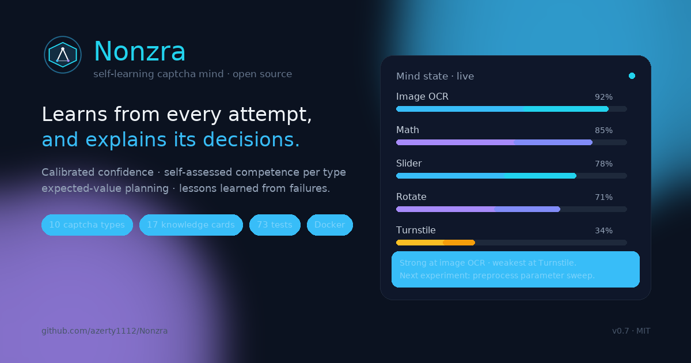
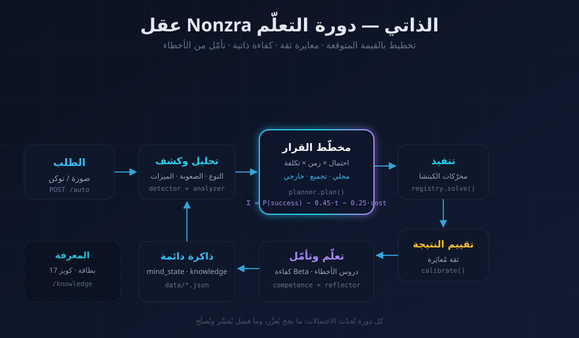

<p align="center">
  
</p>

<h1 align="center">Nonzra</h1>
<p align="center"><strong>عقل ذاتي لحل الكبتشا — يتعلّم من كل محاولة ويشرح قراره</strong></p>
<p align="center"><strong>خادم كامل · مجاني 100% · بلا حدود طلبات · بلا مفتاح إلزامي</strong></p>
<p align="center"><code>bash run.sh</code> ثم افتح <code>http://localhost:8000</code></p>

<p align="center">
  
</p>

<p align="center">
  
  
  
  
  
  
</p>

# Nonzra — إطار عمل مفتوح المصدر ومُستضاف ذاتيًا لحل الكبتشا تلقائيًا

إطار عمل متكامل ومفتوح المصدر ومُستضاف ذاتيًا لحل الكبتشا (CAPTCHA Solver)، يقابل خدمة NoneCap بأكثر من ذلك، مع دعم جميع أنواع الكبتشا الشائعة وميزات متقدمة.

## الميزات الرئيسية

| الميزة | التفاصيل |
|--------|-----------|
| **مجاني بلا حدود** | لا حصة، لا 429 افتراضيًا، ولا مفتاح إلزامي؛ حدود اختيارية بمتغير بيئة واحد |
| **صفحة عامة جاهزة** | `/` صفحة تعريف + حل صورة مباشر من المتصفح بلا تسجيل |
| **نشر بضغطة** | `run.sh` · Docker Compose · Fly.io · Render · Railway · VPS + Caddy HTTPS |
| **محرك حل محلي** | لا يعتمد على خدمة خارجية مدفوعة؛ يعمل بالكامل على أجهزة المستخدم |
| **سيرفر API RESTful** | نقاط نهاية للحل متزامن وغير متزامن مع دعم WebSocket للتقدم الفعلي |
| **كل أنواع الكبتشا** | صورة/نص، hCaptcha (عادي ومؤسسي)، reCAPTCHA v2/v2-invisible/v3، Cloudflare Turnstile، Drag puzzles، Point-on-image، Text، Math |
| **معالجة صور متقدمة** | تبييض، تباين، إزالة ضوضاء، تقطيع، تعديل الإمالة (deskew)، OCR عبر Tesseract |
| **التعلم العميق** | نموذج CNN لتعريف حروف الكبتشا (اختياري، عند توفر PyTorch) |
| **عميل بايثون SDK** | متزامن (`NoneCap`) وغير متزامن (`NoneCapAsync`) مع typing كامل |
| **عميل تايبسكريبت SDK** | Node.js، Bun، Deno، متصفح، مع دعم WebSocket |
| **أداة سطر أوامر (CLI)** | أمر `nonecap` للحل والفحص والإحصائيات من التيرمينال |
| **تكامل متصفح حقيقي** | Playwright لفتح متصفح والتقاط الكبتشا وحله مباشرة |
| **إضافة كروم (Manifest V3)** | كشف تلقائي وحل للكبتشا أثناء التصفح، إعدادات عبر Pop-up |
| **لوحة تحكم HTML** | `/dashboard` لمراقبة الإحصائيات والحل السريع |
| **مقاييس Prometheus** | endpoint `/metrics` لمراقبة الأداء ومعدل النجاح |
| **مفاتيح API** | حماية النقاط endpoints عبر Bearer token مع controle المعدل لكل مفتاح |
| **قاعدة بيانات** | SQLite لتخزين محاولات الحل والإحصائيات (اختيارية) |
| **قاعدة معرفة الأنماط** | تخزن الحلول الناجحة وتستفيد من التشابه لحل كبتشا مشابه فورًا |
| **محرك الخبرة** | يُقيّم مستوى ذكاء النظام (1-10) وحكمة القرارات بناءً على الخبرة المتراكمة |
| **التوسع التلقائي للعامل** | يزيد عدد العمال تلقائيًا حسب عمق طابور المهام |
| **الحل الجماعي (Bulk)** | حل عشرات الكبتشا في دفعة واحدة مع تتبع حالة كل مهمة |
| **ويب هوكس** | إرسال النتائج تلقائيًا إلى عناوين خارجية عند الانتهاء مع إعادة المحاولة |
| **واجهة ويب احترافية** | لوحة تحكم واحدة-page مع إحصائيات مباشرة، سجل حي، وإدارة المفاتيح |
| **عقل ذاتي (Mind)** | معايرة ثقة، كفاءة لكل نوع، مخطّط قرار بالقيمة المتوقعة، وتأمّل من الأخطاء |
| **ذاكرة دائمة** | يحفظ ما تعلّمه (`data/*.json`) ويعيد تحميله بعد إعادة التشغيل |
| **ذخيرة معرفية** | 17 بطاقة معلومات وتقنيات ومصائد + كويز تدريب مولّد |
| **يشرح قراره** | لكل نوع: المسار المختار، احتماله، وما يعرفه عن مصائده |
| **هوية بصرية** | شعار SVG، أيقونة، مخطط معمارية، وبطاقة معاينة اجتماعية |
| **Docker / Compose** | تشغيل مبسط عبر حاوية واحدة |
| **حلّال العمليات الحسابية** | يقرأ `5 + 3` من الصورة ويعيد الناتج — تقييم آمن بدون `eval` |
| **حلّال نصوص مخصّص** | محرّك نصوص (أحرف/أرقام) بقوائم أحرف مسموحة لرفع الدقة |
| **مولّد بيانات صناعية** | توليد صور كبتشا مُسمّاة (تشويش، تدوير، ضوضاء) لتدريب CNN أو الاختبار |
| **حلّ دفعات متزامن** | `POST /batch/solve` حتى 50 صورة في طلب واحد |
| **اكتشاف القدرات** | `GET /capabilities` يعرض الأنواع المدعومة والمحرّكات المسجّلة فعليًا |
| **واجهة ويب محدّثة** | عنوان نسبي (يعمل خلف أي بروكسي)، عرض مسار القرار والتنبيهات، وقائمة أنواع ديناميكية |
| **معالجة صور متقدمة** | تبييض، تباين، إزالة ضوضاء، تقطيع، تعديل الإمالة (deskew)، OCR عبر Tesseract |

## طبقة الذكاء المتكاملة

يحتوي المشروع على طبقة `intelligence/` تضيف أبعادًا متكاملة من الذكاء، ثم تجمعها في طبقة ذاتية تعمل دون تدخل بشري.

### 1. الذكاء التحليلي (`analysis.py`)
يحلل صورة الكبتشا قبل الحل ويحدد:
- درجة الصعوبة (0.0 سهل إلى 1.0 صعب جدًا)
- معدل النجاح المتوقع ووقت الاستجابة المقدر
- الميزات المرئية: التباين، السطوع، كثافة الحواف، الضوضاء، عدد الأحرف
- الاستراتيجية الموصى بها: `local_ocr`، `ensemble_ocr`، أو `external_service`
- نقطة النهاية: `POST /analysis/image`

### 2. الذكاء الحل (`solver_strategy.py`)
يختار أنسب استراتيجية حل بشكل تكيفي:
- `local_primary`: الحل المحلي أولًا للحالات السهلة
- `external_primary`: الخدمة الخارجية أولًا للحالات الصعبة
- `ensemble_with_fallback`: تجميع محركات متعددة ثم حل احتياطي خارجي
- يحسب عتبة الثقة المحايدة وأقصى عدد المحاولات بناءً على Schwierية التحدي

### 3. الذكاء المراقب (`monitor.py`)
يسجل كل محاولة حل ويكشف الشذوذ تلقائيًا:
- معدل النجاح، متوسط زمن الاستجابة، وتجميع الأخطاء حسب النوع
- تنبيهات ذكية (info/warning/critical) عند انخفاض معدل النجاح أو ارتفاع الكمون
- نقطة النهاية: `GET /monitor` مع تقرير وتوصية تلقائية

### 4. الذكاء التفاعلي البشري (`human_behavior.py`)
يقلد السلوك البشري لتجنب الكشف الآلي:
- تأخيرات عشوائية بين الإجراءات (كتابة، نقر، تحريك ماوس)
- حركات ماوس بمنحنى بييزيير غير خطي (تسريع ثم إبطاء)
- احتمالية التردد قبل الإجراء، واحتمالية خطأ كتابي ثم تصحيحه
- ملف سلوك قابل للتخصيص (سرعة الكتابة، عامل الاهتزاز، إلخ)

### 5. الطبقة الذاتية الكاملة (`detector.py` + `tuner.py` + `learning.py` + `orchestrator.py` + `worker.py`)

حل ذاتي من البداية للنهاية: لا تحتاج لتحديد نوع الكبتشا أو معاملات المعالجة أو متابعة المحاولات.

- **كشف تلقائي** (`detector.py`): يصنّف نوع التحدي (image / point / drag / grid) من ميزات الصورة (التشبع، المكونات، المحاذاة، نسبة الأبعاد).
- **ضبط تكيفي** (`tuner.py`): يتعلم أفضل تركيبة `psm` / `threshold` / `denoise` لكل نوع عبر سجل نجاح/ثقة/كمون.
- **تعلّم معزز** (`learning.py`): epsilon-greedy multi-armed bandit يختار أفضل استراتيجية ويقلل الاستكشاف تدريجيًا.
- **منسّق ذاتي** (`orchestrator.py`): خط أنابيب كامل: كشف ← تحليل ← قرار ← ضبط ← حل ← تقييم ← **تصعيد تلقائي** ← تعلّم ← مراقبة، مع أثر قرارات (`trace`).
- **عامل خلفي** (`worker.py`): قائمة مهام غير متزامنة بمعالجة متوازية، تُشغَّل تلقائيًا مع السيرفر.
- نقاط النهاية: `POST /auto`، `POST /auto/async`، `GET /auto/job/{id}`، `GET /auto/status`، `POST /feedback`

### 6. قاعدة معرفة الأنماط (`knowledge_base.py`)

تخزن كل حل ناجح كبصمةomorphometrics (بصمةiformية) للصور مع النص المحلول ومعدل النجاح. عند مواجهة كبتشا جديد، يُقارن بميزات الأنماط المخزنة؛ إذا وُجد تطابق عالٍ (>0.75)، يُستخدم الحل المعروف فورًا دون إعادة الحل.

- **بصمة الميزات**: تجزئة SHA-256 لخصائص الصورة (التشبع، عدد المكونات، متوسط العرض/الارتفاع، إلخ).
- **الاقتراب الذكي**: يُعطي أولوية للأنماط ذات معدل نجاح عالٍ وميزات مشابهة.
- **تحديث معدل النجاح**: كل محاولة (نجاح أو فشل) تُحدّث نسبة نجاح النمط.

### 7. محرك الخبرة (`experience_engine.py`)

يُقيّم مستوى ذكاء النظام بناءً على الخبرة المتراكمة:

- **مستوى الخبرة** (1-10): يرتفع مع عدد الحلول الناجحة (عتبات: 10, 50, 150, 400, 1000, 2500, 5000, 10000).
- **درجة الحكمة** (0-1): combined من معدل النجاح، عدد الأنماط المخزنة، ومستوى الخبرة.
- **التأكيد التلقائي**: الحلول عالية الثقة (≥0.85) تُؤكد تلقائيًا وتُضاف لقاعدة المعرفة كبيانات تدريب.
- **نقاط النهاية**: `GET /experience/stats`، `GET /experience/knowledge`، `POST /experience/find`

### 8. قاعدة معرفة الأنواع الشاملة (`captcha_knowledge.py`)

يحتوي النظام على معرفة مسبقة بكل أنواع الكبتشا المدعومة، مع خصائص كل نوع، استراتيجية الحل الموصى بها، معاملات المعالجة المسبقة، وقواعد الكشف التلقائي:

| النوع | الفئة | الصعوبة | الاستراتيجية | الخدمة الخارجية |
|-------|-------|---------|-------------|----------------|
| `image` | صورة/نص | 0.3 | local_primary | لا |
| `text` | نصي | 0.25 | local_primary | لا |
| `math` | حسابي | 0.3 | local_primary | لا |
| `point` | تحديد نقطة | 0.4 | local_primary | لا |
| `drag` | سحب عناصر | 0.5 | local_primary | لا |
| `turnstile` | Cloudflare Turnstile | 0.6 | external_primary | نعم |
| `grid` | شبكة صور | 0.6 | ensemble_with_fallback | لا |
| `hcaptcha` | hCaptcha | 0.7 | external_primary | نعم |
| `funcaptcha` | FunCaptcha | 0.7 | external_primary | نعم |
| `recaptcha_v2` | reCAPTCHA v2 | 0.65 | external_primary | نعم |
| `geetest` | GeeTest | 0.75 | external_primary | نعم |
| `recaptcha_v2_invisible` | reCAPTCHA v2 غير مرئي | 0.75 | external_primary | نعم |
| `recaptcha_v3` | reCAPTCHA v3 | 0.8 | external_primary | نعم |
| `hcaptcha_enterprise` | hCaptcha Enterprise | 0.85 | external_primary | نعم |

- **الكشف التلقائي**: يُصنّف النوع من ميزات الصورة (المكونات، التشبع، المحاذاة، نسبة الأبعاد) دون تدخل بشري.
- **الضبط التكيفي**: يُختار أفضل معالجات (psm، threshold، denoise) لكل نوع بناءً على سجل النجاح.
- **أنماط معروفة**: يُخزّن النظام أنماطًا ناجحة مسبقة (مثل "AB12"، "1234"، "5+3") لاستخدامها فورًا عند مطابقة الميزات.
- **نقاط النهاية**: `GET /experience/knowledge`، `POST /experience/find`

## تشغيل خادم مجاني بلا حدود

```bash
git clone https://github.com/azerty1112/Nonzra && cd Nonzra
bash run.sh
```

| الصفحة | المسار |
|--------|--------|
| الصفحة العامة (حل صورة مباشر) | `http://localhost:8000/` |
| لوحة التحكم | `http://localhost:8000/dashboard` |
| توثيق API تفاعلي | `http://localhost:8000/docs` |
| حالة الخادم والحدود | `http://localhost:8000/status` |
| مقاييس Prometheus | `http://localhost:8000/metrics` |

```bash
# بلا مفتاح وبلا حد
curl -X POST http://localhost:8000/auto -F "file=@captcha.png"

# حالة الوضع
curl -s http://localhost:8000/status | python -m json.tool
# { "mode": "unlimited", "free": true, "requires_api_key": false, ... }
```

| النشر | الملف | ملاحظة |
|-------|-------|--------|
| محلي | `run.sh` | يثبّت الناقص ثم يشغّل |
| Docker | `docker-compose.yml` | منفذ 8000 + تخزين دائم |
| إنتاجي + HTTPS | `docker-compose.prod.yml` + `Caddyfile` | شهادة تلقائية |
| Fly.io | `fly.toml` | `fly launch --now --copy-config` |
| Render | `render.yaml` | خطة مجانية + قرص 1GB |
| Railway | `railway.json` + `Procfile` | نشر مباشر |

التفاصيل الكاملة في **[docs/FREE_SERVER.md](docs/FREE_SERVER.md)**.

## عقل Nonzra الذاتي

النظام لا يتبع قواعد ثابتة («إذا صعبة → خارجي»)، بل يبني قراره من بياناته:

<p align="center">
  
</p>

| المكوّن | الملف | ما يفعله |
|---------|-------|----------|
| **المعايرة** | `intelligence/calibration.py` | يحوّل ثقة المحرّك الخامّة إلى احتمال نجاح مُقاس (isotonic/PAVA) + قياس Brier |
| **الكفاءة** | `intelligence/competence.py` | توزيع Beta لكل نوع + EWMA للزمن والاتجاه، وترتيب نقاط القوة/الضعف |
| **المخطّط** | `intelligence/decision_planner.py` | يقارن المسارات بـ `P(نجاح) − 0.45·زمن − 0.25·تكلفة` ويشرح الفرق |
| **المتأمّل** | `intelligence/reflector.py` | يصنّف سبب كل إخفاق، يقترح إجراءً، ويقيس فعّالية النصيحة لاحقًا |
| **الذاكرة** | `intelligence/mind.py` | يربط الأربعة في دورة: تخطيط → تنفيذ → تقييم → تعلّم → تأمّل، ويحفظ الحالة |
| **الذخيرة** | `intelligence/knowledge_corpus.py` | 17 بطاقة (أنواع، تقنيات، مخاطر) + مولّد أسئلة تدريب |

### مثال: ماذا يقول العقل؟

```bash
nonecap mind        # تقرير: التقييم، المهارات، الدروس، التجربة القادمة
nonecap plan --type slider --external
```

```text
اخترت ensemble_with_fallback لنوع slider (احتمال نجاح 84% وزمن ~1600ms)
 — أفضل من local_primary بفارق 0.07
المسار: ensemble_with_fallback  |  طاقة متوقعة: 0.6232
  - ensemble_with_fallback     ثقة 0.84  قيمة +0.623
  - local_primary              ثقة 0.63  قيمة +0.553
  - nvidia_api                 ثقة 0.87  قيمة +0.436
```

```text
تقييم الكفاءة : 94.44%
الحالة        : واثق ومرتاح — معدلات النجاح عالية
المعايرة      : 0.0653 (Brier، أقل أفضل)
المهارات:
  image  ███████████████████  94%  (قوي)
ملاحظات العقل:
  • أنا قوي في «image» بنسبة نجاح ~94%
  • أحتاج تحسين «turnstile» (نجاح ~8%)
```

### كيف يتعلّم ذاتيًا؟
1. **قبل الحل**: يسأل عن كفاءته في النوع + أولوية الصعوبة من الذخيرة → يختار المسار.
2. **بعد الحل**: يُسجّل النتيجة في Beta + يحسب ثقة معايَرة + يقارنها بالثبوت.
3. **عند الفشل**: يستخرج سببًا جذريًا («مهلة»، «قالب منخفض التباين»، «لا محرّك مسجّل») ويحوّله إلى نصيحة.
4. **عند النجاح بعد نصيحة**: يقيس فعّالية النصيحة ويرفع وزنها.
5. **كل 10 دورات**: يحفظ الحالة على القرص، فلا يبدأ من الصفر بعد إعادة التشغيل.
6. **الاستكشاف الموجّه**: يختار أضعف نوع لديه ويقترح التجربة القادمة بنفسه.

| نقطة نهاية | الوظيفة |
|------------|---------|
| `GET /mind` | تقرير كامل: تقييم، مهارات، معايرة، دروس، خطة، ملاحظات |
| `POST /mind/plan` | أفضل مسار لنوع + شرح |
| `POST /mind/observe` | تغذية العقل بنتيجة خارجية ليتعلّم منها |
| `GET /mind/accept?confidence=` | هل نقبل النتيجة أم نعيد؟ (بالطاقة المتوقعة) |
| `GET /mind/skills` | كفاءة كل نوع وترتيبها |
| `GET /mind/calibration` | منحنى المعايرة وBrier |
| `GET /mind/reflect` | الدروس ومدى فعّالية النصائح |
| `GET /knowledge` | كل بطاقات المعرفة |
| `GET /knowledge/for/{type}` | معرفة نوع + مصائده + قرار العقل |
| `GET /knowledge/quiz` | أسئلة تدريب مولّدة |

## هيكل المشروع

```
nonecap-clone/
├── README.md
├── pyproject.toml
├── Dockerfile
├── docker-compose.yml
├── install.sh
├── deploy.sh
├── .github/workflows/ci.yml
├── .gitignore
├── api_server/                 # السيرفر (FastAPI)
│   ├── __init__.py
│   ├── main.py                 # جميع نقاط النهاية + لوحة التحكم + المقاييس
│   └── requirements.txt
├── solver_engine/              # محرك الحل المحلي
│   ├── __init__.py
│   ├── base.py                 # CaptchaType, SolverResult, BaseSolver
│   ├── preprocess.py           # معالجات الصور (otsu, adaptive, denoise, deskew, segment)
│   ├── image.py                # حلّال صور نصية (Tesseract OCR)
│   ├── hcaptcha.py             # hCaptcha (محلي + خدمة خارجية)
│   ├── hcaptcha_live.py        # حلّ hCaptcha مباشرة عبر بروتوكوله العام (بلا خدمة مدفوعة)
│   ├── ocr.py                  # OCR موحّد: RapidOCR ← Tesseract ← قالب
│   ├── net.py                  # إعدادات الشبكة/الوكيل للاستدعاءات الخارجية
│   ├── recaptcha.py            # reCAPTCHA v2/v3
│   ├── turnstile.py            # Cloudflare Turnstile
│   ├── drag.py                 # Drag puzzle (template matching)
│   ├── point.py                # Point-on-image (تحديد الهدف باللون)
│   ├── cnn.py                  # نموذج CNN للتعلم العميق (اختياري)
│   ├── db.py                   # قاعدة بيانات SQLite للإحصائيات (اختيارية)
│   └── registry.py             # سجل المحركات مع فولباك تلقائي
├── cli/                        # أداة سطر الأوامر
│   ├── __main__.py
│   ├── nonecap_cli.py
│   └── pyproject.toml
├── browser/                    # تكامل Playwright
│   ├── playwright_solver.py
│   └── pyproject.toml
├── intelligence/               # طبقة الذكاء المتكاملة والذاتية
│   ├── __init__.py
│   ├── monitor.py              # المراقبة الذكية واكتشاف الشذوذ
│   ├── analysis.py             # تحليل صعوبة الكبتشا وتوقع النجاح
│   ├── solver_strategy.py      # استراتيجيات الحل الذكية والتجميع
│   ├── human_behavior.py       # محاكاة السلوك البشري (ماوس، كتابة، تأخيرات)
│   ├── detector.py             # الكشف التلقائي لنوع الكبتشا
│   ├── tuner.py                # الضبط التكيفي لمعاملات المعالجة
│   ├── learning.py             # محرك التعلّم المعزز (bandit)
│   ├── orchestrator.py         # المنسّق الذاتي الكامل مع التصعيد
│   ├── worker.py               # العامل الخلفي غير المتزامن
│   ├── knowledge_base.py       # قاعدة معرفة الأنماط الناجحة
│   ├── captcha_knowledge.py    # معرفة شاملة لأنواع الكبتشا_ALL_TYPES
│   └── experience_engine.py    # محرك الخبرة ومستوى الذكاء
├── web/                        # واجهة الويب الاحترافية
│   ├── templates/
│   │   └── dashboard.html      # لوحة تحكم واحدة-page
│   └── static/
│       ├── css/dashboard.css   # أنماط التصميم
│       └── js/dashboard.js     # تفاعل الواجهة مع API
├── clients/
│   ├── python/nonecap/         # عميل بايثون (client.py, async_client.py)
│   └── typescript/src/         # عميل تايبسكريبت (client.ts)
├── extension/                  # إضافة كروم (Manifest V3)
│   ├── manifest.json
│   ├── content.js
│   ├── background.js
│   ├── popup.html
│   └── popup.js
├── tests/
│   ├── test_solver.py          # اختبارات محرك الحل (9 اختبارات)
│   ├── test_api.py             # اختبارات تكامل للسيرفر (4 اختبارات)
│   ├── test_autonomous.py      # اختبارات الطبقة الذاتية (18 اختبارًا)
│   └── conftest.py (تلقائي)
└── docs/
    └── API.md
```

## التثبيت والتشغيل السريع

### باستخدام بايثون مباشرة
```bash
cd nonecap-clone
pip install -r api_server/requirements.txt
uvicorn api_server.main:app --reload --host 0.0.0.0 --port 8000
```

### باستخدام السكريبت المساعد
```bash
chmod +x install.sh
./install.sh
```

### باستخدام دوكير كومبوز
```bash
chmod +x deploy.sh
./deploy.sh
# السيرفر على http://localhost:8000
# لوحة التحكم: http://localhost:8000/dashboard
# المقاييس: http://localhost:8000/metrics
```

## نقاط نهاية API

| الطريقة | المسار | الوصف |
|--------|--------|-------|
| GET | `/health` | فحص حالة السيرفر |
| GET | `/stats` | إحصائيات المحاولات ومعدل النجاح |
| GET | `/metrics` | مقاييس Prometheus |
| GET | `/dashboard` | لوحة تحكم HTML |
| GET | `/monitor` | تقرير المراقبة الذكية والتنبيهات |
| POST | `/analysis/image` | تحليل صورة كبتشا قبل الحل |
| POST | `/solve/{type}` | حل متزامن (أنواع: image, hcaptcha, recaptcha_v2, recaptcha_v3, turnstile, drag, point) |
| POST | `/solve/async/{type}` | إرسال مهمة غير متزامنة (تُرجع job_id) |
| GET | `/job/{job_id}` | استعلام عن نتيجة مهمة غير متزامنة |
| WS | `/ws/job/{job_id}` | متابعة التقدم الفعلي عبر WebSocket |
| POST | `/auto` | **حل ذاتي كامل**: كشف تلقائي + ضبط + تصعيد + تعلّم |
| POST | `/auto/async` | إرسال مهمة للعامل الخلفي الذاتي (تُرجع job_id) |
| GET | `/auto/job/{job_id}` | استعلام عن مهمة العامل الذاتي |
| GET | `/auto/status` | حالة العامل والتعلّم والضبط والمراقبة |
| POST | `/feedback` | تغذية تعلّم خارجية لتحسين القرارات |
| POST | `/api/keys` | إنشاء مفتاح API جديد |
| GET | `/api/keys` | قائمة مفاتيح API |
| DELETE | `/api/keys/{key_id}` | إلغاء مفتاح API |
| POST | `/bulk/auto` | حل جماعي لدفعات من الكبتشا |
| GET | `/bulk/{bulk_id}` | حالة مهمة حل جماعي |
| GET | `/self-improve/stats` | إحصائيات التعلم الذاتي |
| POST | `/self-improve/confirm/{id}` | تأكيد عينة للتدريب الذاتي |
| POST | `/self-improve/retrain` | إعادة تدريب النموذج الذاتي |
| GET | `/experience/stats` | إحصائيات خبرة النظام ومستوى الذكاء |
| GET | `/experience/knowledge` | إحصائيات قاعدة المعرفة |
| POST | `/experience/find` | البحث عن حل معروف لنمط مشابه |
| GET | `/web` | لوحة التحكم الاحترافية (واجهة ويب) |
| GET | `/` | تحويل إلى `/dashboard` |
| GET | `/capabilities` | الأنواع المدعومة + المحرّكات المسجّلة لكل نوع |
| POST | `/solve/math` | حل صورة كبتشا حسابية (يعيد الناتج) |
| POST | `/solve/text` | حل كبتشا نصية بقائمة أحرف مسموحة |
| POST | `/solve/slider` | حل فجوة السلايدر (إحداثيات `x`, `y`) |
| POST | `/solve/rotate` | تقدير زاوية التصحيح |
| POST | `/batch/solve` | حل حتى 50 صورة base64 في طلب واحد |
| POST | `/math/evaluate` | حساب تعبير رياضي بأمان أو حل صورة حسابية |
| POST | `/synthetic/batch` | توليد صور كبتشا صناعية مع تسمياتها |
| GET | `/synthetic/sample` | صورة كبتشا صناعية واحدة (PNG) |

### مثال الحل الذاتي الكامل (بدون تحديد النوع)
```bash
curl -X POST http://localhost:8000/auto \
  -F "file=@captcha.png" \
  -F "human_like=true" \
  -F "max_escalations=2"
```

### مثال إرسال مهمة ذاتية غير متزامنة
```bash
curl -X POST http://localhost:8000/auto/async -F "file=@captcha.png"
# {"job_id":"...","status":"queued",...}
curl http://localhost:8000/auto/job/<job_id>
```

### مثال استدعاء حل صورة
```bash
curl -X POST http://localhost:8000/solve/image \
  -F "file=@captcha.png" \
  -F "psm=7" -F "preprocess=true"
```

### hCaptcha بلا أي خدمة مدفوعة (البروتوكول العام مباشرة)

```bash
# 1) هل تصل شبكتك إلى hCaptcha؟ وهل OCR جاهز؟
curl "http://localhost:8000/hcaptcha/probe"
curl "http://localhost:8000/ocr/engines"

# 2) حلّ فعلي عبر /checksiteconfig → /getcaptcha → OCR → /checkcaptcha
curl -X POST http://localhost:8000/hcaptcha/live \
  -H 'content-type: application/json' \
  -d '{"sitekey":"10000000-ffff-ffff-ffff-000000000001","url":"https://accounts.hcaptcha.com/demo"}'
```

```bash
python examples/hcaptcha_live_demo.py          # إثبات كامل بلا إنترنت
python examples/hcaptcha_live_demo.py --real    # محاولة على hCaptcha الحقيقية
```

كل التفاصيل، سبب الحجب الشبكي في بيئات السحابة، وكيفية تمرير وكيل:
[`docs/HCAPTCHA_FREE.md`](docs/HCAPTCHA_FREE.md).

### مثال استدعاء hCaptcha
```bash
curl -X POST http://localhost:8000/solve/hcaptcha \
  -H "Content-Type: application/json" \
  -d '{"sitekey":"10000000-ffff-ffff-ffff-000000000001","url":"https://example.com"}'
```

## الاستخدام عبر عميل بايثون

```python
from nonecap_client import NoneCap

nc = NoneCap(base_url="http://localhost:8000")

# حل صورة كبتشا
result = nc.solve_image(image_path="captcha.png")
print("النص:", result.text)

# حل hCaptcha
result = nc.solve_hcaptcha(
    sitekey="...",
    url="https://example.com",
)
print("التوكن:", result.token)

# حل reCAPTCHA v2
result = nc.solve_recaptcha(sitekey="...", url="https://example.com")

# حل Turnstile
result = nc.solve_turnstile(sitekey="...", url="https://example.com")

# حل Drag puzzle (يلزم صورة اللغز وصورة القالب)
result = nc.solve_drag(image_path="drag.png", template_path="template.png")
print("الإحداثيات:", result.text)  # "x,y"

# حل Point-on-image
result = nc.solve_point(image_path="point.png", target_color="red")
print("الإحداثيات:", result.text)

# الحل الذاتي الكامل: كشف النوع تلقائيًا + ضبط + تصعيد + تعلّم
auto = nc.auto(image_path="captcha.png", human_like=True)
print("النوع المكتشف:", auto.detected_type, "الثقة:", auto.detection_confidence)
print("الاستراتيجية:", auto.strategy_used, "التصعيدات:", auto.escalations)
print("النص:", auto.result.text)
print("أثر القرارات:", auto.trace)

# مهمة ذاتية في الخلفية
job_id = nc.auto_submit(image_path="captcha.png")
print(nc.auto_job(job_id))

# حالة العامل والتعلّم والضبط
print(nc.auto_status())

# تغذية تعلّم خارجية
nc.feedback("local_primary", success=True, confidence=0.92, captcha_type="image")

# مهمة غير متزامنة
job_id = nc.solve_async_submit("image", image_path="captcha.png")
result = nc.job_status(job_id)

# الإحصائيات
print(nc.stats())

# غير متزامن (asyncio)
from nonecap_client import NoneCapAsync
async def main():
    async with NoneCapAsync() as nc:
        result = await nc.solve_image(image_bytes=b"...")
```

## الاستخدام عبر أداة سطر الأوامر (CLI)

```bash
# فحص الحالة
nonecap health

# الإحصائيات
nonecap stats

# حل صورة
nonecap solve --type image --image captcha.png

# حل hCaptcha
nonecap solve --type hcaptcha --sitekey "..." --url "https://example.com"

# إرسال مهمة غير متزامنة
nonecap async --type image --image captcha.png

# استعلام عن مهمة
nonecap job <job_id>

# حل ذاتي كامل (كشف تلقائي للنوع)
nonecap auto --image captcha.png --human-like

# إرسال مهمة ذاتية للعامل الخلفي
nonecap auto-async --image captcha.png

# استعلام عن مهمة ذاتية
nonecap auto-job <job_id>

# حالة العامل والتعلّم والضبط
nonecap auto-status

# الأنواع المدعومة فعليًا على السيرفر
nonecap capabilities

# حساب تعبير رياضي (عبر السيرفر أو محليًا)
nonecap math "12 × 4"
nonecap calc "12*4"

# توليد بيانات تدريب صناعية مع ملف تسميات CSV
nonecap generate --count 50 --length 4 --out data/synthetic --labels data/synthetic/labels.csv

# تقرير العقل الذاتي (التقييم، المهارات، الدروس، الخطة)
nonecap mind

# أفضل مسار لنوع معيّن مع شرح السبب
nonecap plan --type slider --external

# معرفة العقل عن نوع (معلومات + مصائد) أو كل البطاقات
nonecap knowledge --type hcaptcha
nonecap knowledge

# كويز تدريب من الذخيرة
nonecap quiz --limit 5
```

> الخيارات العامة (`--base-url`, `--api-key`, `--timeout`) يمكن تمريرها قبل الأمر أو بعده.

## الاستخدام عبر عميل تايبسكريبت

```ts
import { NoneCap } from "nonecap-client";

const nc = new NoneCap({ baseUrl: "http://localhost:8000" });

const result = await nc.solveImage(file);
console.log(result.text);

const token = await nc.solveHCaptcha(sitekey, url);
console.log(token.token);

// الحل الذاتي الكامل: كشف تلقائي + ضبط + تصعيد + تعلّم
const auto = await nc.auto({ human_like: true }, file);
console.log(auto.detected_type, auto.strategy_used, auto.trace);
console.log(auto.result.text);

// مهمة ذاتية غير متزامنة
const jobId = await nc.autoSubmit({}, file);
console.log(await nc.autoJobStatus(jobId));
console.log(await nc.autoStatus());

// متابعة مهمة عبر WebSocket
nc.subscribeJob(jobId, (r) => console.log(r));
```

## إضافة كروم للمتصفح

1. افتح `chrome://extensions`
2- فعّل "Developer mode"
3- انقر "Load unpacked" واختر مجلد `extension/`
4- أضف رابط السيرفر في الإعدادات (افتراضياً `http://localhost:8000`)
5- فعّل الحل التلقائي من الـ Pop-up

## متطلبات النظام

- Python 3.9+
- Tesseract OCR (للحل النصي)
- OpenCV, Pillow, NumPy, pytesseract
- FastAPI, Uvicorn, httpx, pydantic
- اختيارياً: sqlalchemy, slowapi, prometheus-client, torch, playwright

## إضافات الإصدار 0.6

- **حلّال العمليات الحسابية** (`solver_engine/math.py`): يقرأ التعبير عبر OCR، يطبّع رموزًا مثل `×` و`÷` وأخطاء `O/0` الشائعة، ثم يقيّم التعبير عبر AST آمن (لا `eval`) مع رفض الاستدعاءات والأُس الكبير والقسمة على صفر.
- **حلّال النصوص** (`solver_engine/text.py`): `TextSolver` و`NumericSolver` بقوائم أحرف مسموحة (`whitelist`) وإعدادات `psm` مناسبة.
- **تسجيل `slider` و`rotate`**: كانا موجودين في الكود لكن غير مسجّلين في السجل المركزي، فأي طلب لنوعهما كان يفشل بـ«لا يوجد حلّال مسجل».
- **مولّد البيانات الصناعية** (`solver_engine/synthetic.py` + `/synthetic/*` + `nonecap generate`): يولّد صور كبتشا مع تسمياتها لتغذية تدريب CNN أو اختبار المحرّكات دون بيانات خارجية.
- **`/capabilities`**: مصدر حقيقة واحد للأنواع المدعومة، تعتمد عليه لوحة التحكم والـ CLI.
- **`/batch/solve`**: حل متزامن لدفعات صغيرة مع تقرير نجاح/فشل لكل عنصر.
- **`/metrics` أصبح Prometheus حقيقيًا**: كان يعيد JSON بدل صيغة النص القياسية التي يتوقعها السكرابر.
- **إصلاح أماني مهم**: مفتاح تشفير قاعدة البيانات كان يُولّد من جديد في كل استدعاء، فتصبح مفاتيح API المخزّنة غير قابلة للفك بعد إعادة التشغيل. الآن المفتاح يُقرأ من `NONECAP_ENCRYPTION_KEY` أو يُحفظ في `data/.encryption_key` (بصلاحيات 600).
- **إصلاح توافق slowapi**: كل نقطة نهاية محمية بمعدل طلب تحتاج وسيط `request`، وبدونه كان استيراد `api_server.main` يفشل بالكامل عند تثبيت `slowapi`.
- **لوحة التحكم**: عنوان API نسبي بدل `http://localhost:8000` الثابت، عرض صحيح لبنية استجابة `/auto`، قائمة أنواع ديناميكية، وبطاقة قدرات.
- **CORS اختياري** عبر `NONECAP_CORS_ORIGINS`، ورفع `docker-compose` إلى صيغة حديثة مع healthcheck وحجم بيانات دائم.
- **Dockerfile مصحّح**: `libgl1-mesa-glx` (محذوف من Debian 12) و`tesseract-ocr-ara`، واستثناء torch من صورة التشغيل، وإضافة `web/` و`cli/` التي كانت مفقودة.
- **دعم multipart وJSON في `/solve/{type}`**: الوثائق والـ CLI كانا يرسلان `form-data` بينما النقطة تقبل JSON فقط، ما يعني فشل كل استدعاء موثّق بـ 422. الآن تُقرأ الصيغتان، وطلب نوع محلي بلا صورة يعيد 400 برسالة واضحة بدل فشل صامت.
- **ترشيح وسائط المحرّكات في السجل**: كان `min_area` ووسائط مشتركة أخرى تُمرَّر إلى كل الحلّالات، فيفشل `ImageCaptchaSolver` بـ `TypeError` على أي طلب من الـ CLI. الآن يُرشَّح كل حلّال حسب توقيعه.
- **`SliderSolver` أكثر مقاومة**: مطابقة بالحواف (Canny) إلى جانب الشدّة، مع رجوع آمن عند فشل كشف الحواف، ورفض صريح للقوالب منخفضة التباين بدل إجابة عشوائية.
- **`RotateSolver` أدقّ**: تنقيح الزاوية بخطوة درجة بعد البحث الخشن، وإرجاع زاوية الدوران نفسها في `text` مع `correction` في البيانات الوصفية.
- **CI مبسّط وموثوق**: المصادقة بتثبيت خفيف + ruff + اختبارات على 3 نسخ بايثون + بناء صورة وفحص دخاني عبر `curl`، بدل خطوات كانت تحتاج مفاتيح أسرار.

## الهوية البصرية والأصول

| الأصل | المسار |
|-------|--------|
| الشعار الكامل | `web/static/img/logo.svg` |
| علامة مربعة | `web/static/img/logo-mark.svg` |
| أيقونة المتصفح | `web/static/img/favicon.svg` |
| مخطط معمارية العقل | `web/static/img/architecture.svg` |
| بطاقة المعاينة الاجتماعية (1200×630) | `docs/assets/social-preview.png` |

**ألوان الهوية:** `#38bdf8` سماوي أساسي · `#22d3ee` نجاح · `#a78bfa` بنفسجي ذكاء · `#fbbf24` تحذير · `#0f172a` خلفية · `#94a3b8` نص ثانوي.

لإعادة توليد بطاقة المعاينة بعد تعديل النصوص: `python3 docs/assets/render_social.py`

## الترخيص

MIT License - للاستخدام المصرح به في الاختبار، المراقبة، والأتمتة الخاصة بك فقط. يُحظر استخدامه للتحايل على أنظمة الغير دون إذن صريح.

## المساهمة

مساهماتكم مرحب بها! يرجى فتح Issue أو Pull Request.

```bash
# تشغيل الاختبارات
pytest tests/ -v

# فحص الأنواع
mypy solver_engine/ api_server/ clients/python/nonecap/
```
